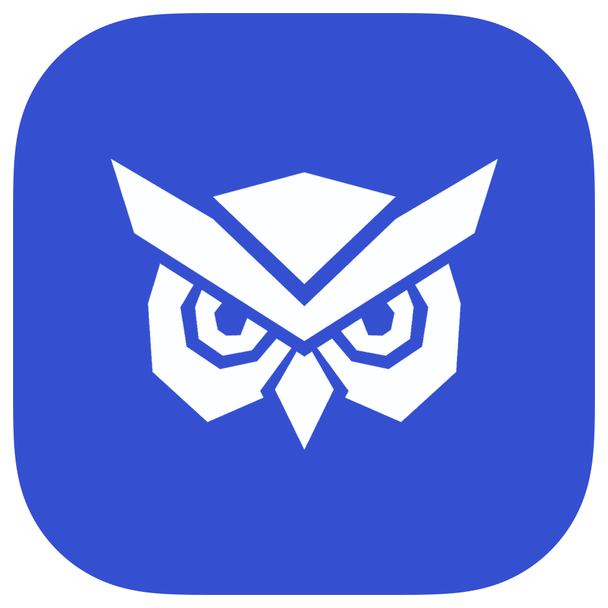

    
    <h1>Midnite</h1>
    

        A privacy-focused Chromium-based browser, based on
        <a href="https://github.com/imputnet/helium">Helium</a>.
    

## About this repository
This repository contains Midnite's shared Chromium patches, resources, and
development tooling. It keeps the same layout and the same external
dependencies as Helium's main repository:

- `patches/` and `patches/series`: the quilt patch series applied to Chromium
- `resources/`: branding assets and the manifests that map them into Chromium
- `utils/` and `devutils/`: build, substitution, and validation tooling
- `i18n/`: UI string translations
- `deps.ini`, `downloads.ini`, `flags.gn`, `chromium_version.txt`: unchanged
  from Helium, so Midnite builds against exactly the same dependencies

See [REBRAND_NOTES.md](REBRAND_NOTES.md) for what was renamed, what was
intentionally left alone, and what to review before shipping builds.

## Relationship to Helium
Midnite is a derivative of [Helium](https://github.com/imputnet/helium),
licensed under GPL-3.0. User-visible branding (product name, UI strings,
icons, logos) is Midnite's. Internal identifiers (`helium_*` file and
directory names, the C++ `helium` namespace, the `helium://` URL scheme,
preference names, and GN targets) are intentionally unchanged so that the
patch series keeps applying and the externally-built dependencies below keep
working without modification.

## Dependencies
Fetched after cloning Chromium (see [deps.ini](deps.ini) and
[downloads.ini](downloads.ini)):

- Prepared Chromium source archives from
  [chromium-tarballs](https://github.com/imputnet/chromium-tarballs)
- [uBlock Origin fork](https://github.com/imputnet/uBlock) with bundled
  filters and defaults
- [Onboarding](https://github.com/imputnet/helium-onboarding) page
  (`helium://setup`)
- [Non-free assets](https://github.com/imputnet/helium-nonfree-assets)
  (search engine icons and similar)

## Credits

### Helium
Midnite is built on [Helium](https://github.com/imputnet/helium) by The
Helium Authors. Their copyright headers are preserved throughout this
repository.

### The Chromium project
[The Chromium Project](https://www.chromium.org/) is at the core of Midnite,
making it possible in the first place.

### ungoogled-chromium
Helium originally branched off
[ungoogled-chromium](https://github.com/ungoogled-software/ungoogled-chromium).
Special thanks to everyone behind ungoogled-chromium, they made working with
Chromium much easier.

### Other Chromium projects
Midnite includes some patches from other open source Chromium projects:

- [Inox patchset](https://github.com/gcarq/inox-patchset)
- [Debian](https://tracker.debian.org/pkg/chromium-browser)
- [Bromite](https://github.com/bromite/bromite)
- [Iridium Browser](https://iridiumbrowser.de/)
- [Brave](https://github.com/brave/brave-core)

All patches are sorted by vendor in the [patches](patches/) directory of this
repo.

## License
All code, patches, modified portions of imported code or patches, and
any other content that is unique to Midnite and Helium and not imported from
other repositories is licensed under GPL-3.0. See [LICENSE](LICENSE).

Any content imported from other projects retains its original license (for
example, any original unmodified code imported from ungoogled-chromium remains
licensed under their [BSD 3-Clause license](LICENSE.ungoogled_chromium)).
